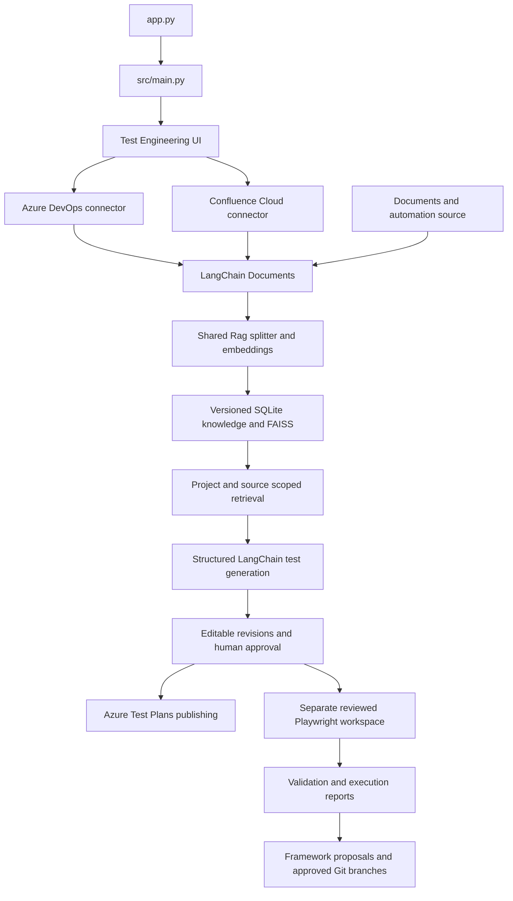

# AI Test Engineering

A Python/Streamlit platform for Azure DevOps test engineering, using LangChain,
Groq, Hugging Face embeddings and FAISS retrieval.

## Run

```powershell
uv sync --locked --extra documents
uv run streamlit run app.py --server.address 127.0.0.1
```

Copy `.env.example` to `.env` only if a `.env` does not already exist, then configure
provider credentials. Enter the Azure DevOps organization URL and PAT in the
Streamlit connection form; the PAT input is masked. The application opens
Test Engineering directly.

## Capabilities

- Azure DevOps PAT authentication and project/team/sprint/story discovery.
- Confluence Cloud, historical work items and document ingestion with incremental sync.
- Project/source-scoped retrieval using the shared RAG splitter and embedding model.
- Structured manual tests, editable revisions, selected-scenario regeneration and approval.
- Approved test publishing to Azure Test Plans and Suites with retry recovery.
- Reviewed Playwright/Cucumber workspaces, screenshot/DOM analysis and execution reports.
- Proposed reusable framework improvements through reviewed Git worktrees and draft PRs.

The old product-review application, sentiment retrievers, review graph and CSV-specific
methods have been removed. The document splitter and embedding configuration were retained.

## Architecture



## Validation

```powershell
uv run python -m unittest discover -s tests -v
uv run python -m examples.offline_demo --output .local/demo
uv run python -m compileall -q src tests examples scripts
```

The offline demo uses mocked services and deterministic model substitutes. It does
not publish live work items or execute generated application tests. The optional
fixed automation-template check is `uv run python -m scripts.validate_automation_template`;
this requires Node.js 22+ and installs Node dependencies for a trusted dry-run fixture.

## Documentation

- [Setup, workflow, module map and deployment limits](docs/test-engineering.md)
- [Implementation status](docs/implementation-status.md)
- [Historical repository assessment](docs/architecture-assessment.md)

This implementation targets trusted local single-user use. Live service integration,
model quality and application locators require environment-specific validation.
