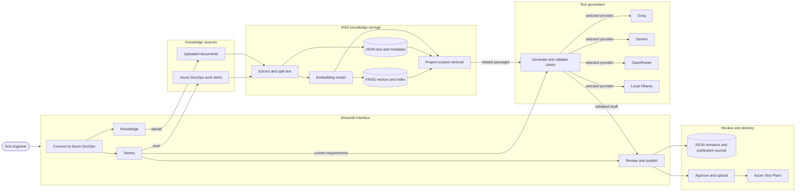

# AI Test Engineering

AI Test Engineering is a Streamlit application for generating and reviewing
manual test cases from Azure DevOps work items. It uses retrieval-augmented
generation (RAG): the selected story and relevant project knowledge are passed
to a Groq, Gemini, OpenRouter, or local Ollama model. A reviewer checks the
resulting test cases before they are uploaded to Azure Test Plans.

The active interface has three tabs: **Stories**, **Knowledge**, and **Review
and publish**. Knowledge vectors are stored in FAISS; document metadata,
review revisions, and publication records are stored in JSON files. The
application does not use SQLite.

## What the application does

- Connects to Azure DevOps using an organization URL and a personal access
  token (PAT) entered in the UI.
- Lists accessible projects, teams, sprints, and work items by name.
- Adds retrieved stories and uploaded documents to project-scoped knowledge.
- Searches the FAISS index for related passages and groups results by source.
- Generates manual test cases using Groq, Gemini, OpenRouter, or a locally
  installed Ollama model.
- Lets a reviewer edit, add, remove, regenerate, and approve cases.
- Publishes approved cases to a selected Azure Test Plan and Test Suite.

## Architecture



The embedding model used by the knowledge index is separate from the Groq,
Gemini, OpenRouter, or Ollama model used for test generation. Selecting
Ollama does not make the embedding service local.

## Requirements

- Python 3.14 and [uv](https://docs.astral.sh/uv/).
- An Azure DevOps organization and a PAT with access to the desired project,
  work items, plans, and suites. Creating plans or test cases requires the
  corresponding Azure permissions.
- A Groq, Gemini, or OpenRouter API key, or a running local Ollama service
  with a model installed.
- A Google API key with access to the configured embedding model.
- PDF, Word, and Excel parsers are installed with the standard dependencies.

### Embedding setup

The current [embedding factory](src/RAG/Rag.py) imports
`langchain_google_genai` and requests the `gemini-embedding-2-preview` model.
The required `langchain-google-genai` package is included in the project
dependencies. Set `GOOGLE_API_KEY` in your local `.env` and verify that your
account can use the configured model. The Hugging Face token in older
configurations does not configure this Google client. See [LangChain's Google
embeddings setup](https://docs.langchain.com/oss/python/integrations/embeddings/google_generative_ai)
for provider configuration.

The default `ENGINEERING_EMBEDDING_VERSION` label still names the older
EmbeddingGemma configuration. The label tracks index compatibility; it does not
choose the embedding model. If changing the embedding implementation, assign a
new unique label and re-index every relevant source before retrieval.

## Install and run

In PowerShell, open the project directory and run:

```powershell
uv sync --locked --inexact
if (-not (Test-Path .env)) { Copy-Item .env.example .env }
```

Configure your local credentials, including `GOOGLE_API_KEY`.
Then start the application:

```powershell
uv run streamlit run app.py --server.address 127.0.0.1
```

Open the local URL printed by Streamlit. Use `Ctrl+C` in the terminal to stop
the server. If you change dependencies or environment settings, restart it.

## Configuration

Enter the Azure organization URL and PAT in **Connect Azure DevOps** each time
you connect. The PAT field is masked, and the form clears after submission.
Azure URL and PAT values are not read from `.env` by the connection form.

Other settings can be supplied through `.env` or the process environment:

| Setting | Purpose |
| --- | --- |
| `AZURE_DEVOPS_API_VERSION` | Optional Azure REST version; defaults to `7.1`. |
| `GROQ_API_KEY` | Optional Groq fallback if the UI key is blank. |
| `GOOGLE_API_KEY` | Google embedding credential for the current embedding factory. |
| `GEMINI_API_KEY` | Optional Gemini generation key fallback if neither a UI key nor `GOOGLE_API_KEY` is set. |
| `OPENROUTER_API_KEY` | Optional OpenRouter generation key fallback if the UI key is blank. |
| `OLLAMA_BASE_URL` | Local Ollama address; defaults to `http://127.0.0.1:11434`. Only loopback hosts are accepted. |
| `ENGINEERING_DATA_DIR` | Local storage root; defaults to `.local/test-engineering`. |
| `ENGINEERING_EMBEDDING_VERSION` | Version label used to detect incompatible stored embeddings. |
| `ENGINEERING_ALLOWED_SOURCES` | Comma-separated source types allowed for retrieval. The code and example default is `azure_devops,confluence,files,approved_tests`; the UI has no Confluence ingestion control. |
| `HUGGINGFACEHUB_API_TOKEN` | Present in the example for an older embedding configuration; not used by the current Google embedding factory. |

The `.env` file and `.local` directory are ignored by Git. Do not commit API
keys, PATs, or local project data.

## Choose a generation model

After connecting and choosing a project, select an **LLM provider**:

### Groq

1. Select **Groq** and choose a model from the list.
2. Enter a key in the masked **Groq API key** field, or configure the
   `GROQ_API_KEY` fallback in `.env`.

The configured model list is in `src/ui/uiconfigfile.ini`. Model availability
and structured-output quality depend on the provider and your account.

### Gemini

1. Select **Gemini** and choose a model, or select **Other model** to enter a
   model ID available to your Google account.
2. Enter the Gemini API key in the masked field. If left blank, the app uses
   `GOOGLE_API_KEY`, then `GEMINI_API_KEY`, from the environment.

The key entered in the UI applies to generation only. Knowledge embeddings
continue to use the Google credentials configured for the embedding client.
Gemini model availability and quota depend on your Google account.
The listed Gemini models use a reduced thinking level to help limit token use;
custom model IDs keep their provider defaults. Reduced thinking can affect the
depth of generated cases, so review the results carefully.

### Ollama

1. Start the local Ollama service.
2. Install a model, for example `ollama pull llama3.2`.
3. Select **Ollama**, click **Refresh local models**, and choose an installed
   model. The application does not download models automatically.

### OpenRouter

1. Select **OpenRouter**. The app loads text models that advertise structured
   output support, putting `:free` variants before other model IDs. Use
   **Refresh OpenRouter models** to update the list.
2. Select a model or **Other model** to enter a model ID, then enter an
   OpenRouter API key in the masked field. If the field is blank, the app uses
   `OPENROUTER_API_KEY` from the environment.
3. `openrouter/free` is listed first. Pricing, availability, and limits vary
   by model and provider; check the [OpenRouter model catalog](https://openrouter.ai/models)
   before selecting a model. Requests and story context are sent to OpenRouter
   and its selected provider. Google embeddings remain configured separately.

The app requires the routed provider to support the structured output
parameters used for test generation. If the model catalog cannot be loaded,
the free router and manual model-ID entry remain available. A custom model
must also support the required structured output. Availability, rate limits,
and pricing can change; selecting a paid model may incur charges.

Use a model that can follow the requested structured test-case schema. Local
model quality and speed depend on the model and available hardware.

## Use the application

### 1. Connect and select a story

1. Expand **Connect Azure DevOps** and enter the organization URL, for example
   `https://dev.azure.com/your-organization`, and your PAT. Click **Connect and
   validate access**.
2. Select a project and generation model, then choose a team and sprint. The
   selectors show names; Azure IDs are retained internally.
3. Adjust the work-item types if needed and click **Retrieve sprint work items**.
   Search by ID or title and select a story.
4. Read its description and acceptance criteria. Use **Load discussion
   history** if comments are needed.

Retrieved work items are added or updated in knowledge when the embedding
service is available. Selecting a story also saves its current revision.
Unchanged content is not re-embedded. If saving or retrieval fails, resolve the
provider problem and use the displayed retry control.

### 2. Add project knowledge

In **Knowledge**:

- Use **Sync project history (full snapshot)** to index accessible Azure work
  items. A successful full snapshot can remove items no longer present in that
  snapshot; a failed fetch preserves the prior knowledge.
- Use **Add business documents** to upload multiple PDF, DOCX, XLSX, CSV, TXT,
  Markdown, JSON, TypeScript, JavaScript, Python, or feature files. The PDF,
  DOCX, and XLSX parsers are included in the standard installation. PDFs must
  contain extractable text; scanned pages without text cannot be indexed.
- Use **Force re-index synchronized documents** when deliberately rebuilding
  synchronized sources.

Uploads are indexed automatically. A changed file with the same name replaces
its earlier indexed version; use different names for distinct documents.
Previously indexed content from other allowed source types can remain in the
index even though the UI does not provide controls to ingest it.

### 3. Generate and review tests

On **Stories**, expand **Related knowledge** to inspect the passages retrieved
for the selected story. Results from the same source appear under one heading.
Click **Generate manual test cases**, then open **Review and publish**.

To limit token use, generation sends up to four ranked knowledge excerpts of
800 characters each, retaining their source references. Coverage follow-ups
use up to two excerpts and request missing criteria in batches of six, with up
to four follow-up batches per generation.
Regeneration sends only the selected cases rather than the entire draft. The
story title, description, and acceptance criteria are retained for initial
generation and validation; stored source documents and the displayed knowledge
are unchanged.

Reviewers can edit titles, descriptions, preconditions, priority, category,
references, and step tables; add or remove cases; regenerate selected cases;
and inspect revision history. JSON is handled in the backend rather than used
as the test-case editor.

Validation checks the schema, story ID, step numbering, duplicate titles,
references, and acceptance-criteria coverage. When generated cases miss
criteria, the application requests additional cases in small batches. If any
criteria remain uncovered, the partial draft is saved for review and the UI
lists the missing criteria. Add or edit cases and assign the appropriate
criteria before approving or uploading. Validation does not prove that
generated cases are semantically correct: review the actions, expected
results, test data, assumptions, and coverage before approval.

### 4. Approve and upload

Enter a **Test Plan ID** and **Test Suite ID**, or expand **Find or create a
test plan and suite** to load available items or create them. Click **OK -
approve and upload** to save the displayed edits, approve that revision, and
publish the cases to the selected suite. The UI displays the resulting Azure
IDs and status.

**Approve without uploading** records approval separately. An approved set can
also be added to project knowledge. The publisher verifies the target project,
plan, suite, and current story revision. Local publication records and remote
fingerprint tags help recover from partial failures; verify the final results
in Azure, especially after a failed or repeated request.

## Storage and backup

The default layout is:

```text
.local/test-engineering/
  <identity-hash>/
    <organization-and-project-hash>/
      knowledge.json                  document text, metadata, and sync status
      vectors-<id>.faiss              persisted document vectors
      knowledge-<source-hash>.faiss   scoped search index
      knowledge-<source-hash>.manifest.json
      workflow.json                   revisions, approvals, and publication records
      knowledge.lock / workflow.lock  local write locks
```

`knowledge.json` is stored inside the identity and project folders, not at the
storage root. FAISS stores vectors while the JSON sidecar supplies the text and
metadata required to display retrieved passages. The scoped FAISS index can be
rebuilt from the persisted vector files if the scoped index is damaged.

Back up the entire project folder, including all `.faiss` and JSON files.
These files can contain business requirements and generated tests; protect
them with appropriate local access controls. Older vector shards are retained
after updates and can increase disk use.

Changing the embedding model or vector dimensions requires a new
`ENGINEERING_EMBEDDING_VERSION` and a complete re-index of every relevant
source. A partial sync can leave older sources incompatible until they are
also re-indexed.

## Troubleshooting

| Problem | What to check |
| --- | --- |
| Azure connection fails | Organization URL, PAT validity, organization policy, project access, and API version. |
| No Ollama models are listed | Start Ollama, install a model, check the local address, and click **Refresh local models**. |
| OpenRouter request fails | Check the API key, model availability and structured-output support, account credits, and rate limits. |
| A Python package or document parser is missing | Run `uv sync --locked --inexact`, stop the current app, and start it with `uv run streamlit run app.py`. |
| Windows shows a reentrant console error while stopping | Install the locked dependencies with `uv sync --locked --inexact` and restart with `uv run streamlit run app.py`. The locked Streamlit version includes the upstream shutdown fix. |
| Embedding authentication, quota, or model error | Check the Google key, account access, model availability, and provider limits. |
| Google returns HTTP 503 | The app retries temporary 503 errors up to four attempts. If Google remains unavailable, retry later; for generation you can also select another available Gemini model. |
| Embedding version changed | Set the intended version label and re-index all relevant sources. |
| Generation fails validation | The app retries malformed structured output once. If it still fails, check model availability, context size, and structured-output support; retry or choose another model. |
| Upload fails | Verify project permissions, plan and suite IDs, and story revision; inspect Azure for partial results before retrying. |

## Project files

| Path | Purpose |
| --- | --- |
| `app.py`, `src/main.py` | Streamlit entry point and environment loading. |
| `src/ui/streamlitui/` | Connection, story, knowledge, and review interface. |
| `src/integrations/azure_devops.py` | Azure DevOps REST integration. |
| `src/RAG/Rag.py` | Text splitter and embedding factory. |
| `src/test_engineering/knowledge.py` | Document ingestion, FAISS storage, and retrieval. |
| `src/test_engineering/workflow.py` | Test generation, validation, and revision storage. |
| `src/test_engineering/publishing.py` | Approval and Azure Test Plans publishing. |
| `src/test_engineering/storage.py` | File locking and atomic writes. |
| `src/LLMS/` | Groq, Gemini, OpenRouter, Ollama, structured output, and provider diagnostics. |
| `tests/`, `examples/offline_demo.py` | Automated checks and a mocked end-to-end demonstration. |

## Verification

```powershell
uv run python -m unittest discover -s tests -v
uv run python -m examples.offline_demo --output .local/demo
uv run python -m compileall -q src tests examples scripts
```

The demo and automated tests use mocked services or deterministic substitutes.
They do not verify live Azure permissions, provider credentials, or model
quality. Validate those in the target environment before relying on generated
test cases or publishing results. The application currently targets a trusted
local, single-user deployment; historical files under `docs/` may describe
earlier versions of the framework.
