# AI Test Engineering

A Streamlit application that reads Azure DevOps work items, retrieves related
project knowledge, generates manual test cases with a language model, and
uploads reviewed cases to Azure Test Plans. It uses LangChain for generation
and retrieval, FAISS for knowledge vectors, and JSON for document metadata,
review history, and publication records.

The active interface contains **Stories**, **Knowledge**, and **Review and
publish**. Automation and Framework Evolution controls are disabled in the UI;
their backend modules remain in the repository.

## Requirements

- Windows, macOS, or Linux with Python 3.14 and [uv](https://docs.astral.sh/uv/).
- An Azure DevOps organization, accessible project, and PAT with access to the
  work items and Test Plans you intend to use. The required permissions depend
  on your organization's policies and on whether you create plans, suites, or
  test cases.
- A Groq API key, or a running local Ollama service with a model installed.
- An embedding provider and credentials. **See the setup issue below before
  attempting to index stories or documents.**

### Current embedding setup issue

The current [`Rag.create_embeddings`](src/RAG/Rag.py) implementation imports
`langchain_google_genai` and selects `gemini-embedding-2-preview`. However,
`langchain-google-genai` is not declared in the project dependencies, and the
example environment file still describes Hugging Face. A fresh installation
therefore cannot create the configured embeddings until this mismatch is fixed.
Hugging Face settings in `.env.example` do not configure the current Google
embedding client.

To use the current Google implementation, add the integration to the project
and configure Google credentials according to the [LangChain Google embedding
documentation](https://docs.langchain.com/oss/python/integrations/text_embedding/google_generative_ai).
For example, from the project directory:

```powershell
uv add langchain-google-genai
```

Set `GOOGLE_API_KEY` in your local `.env`, and confirm that your account can use
the configured model. Adding the dependency changes `pyproject.toml` and
`uv.lock`. No live Google embedding request has been verified for this project.
If an index was created using another embedding model, follow the re-indexing
instructions below before using it. Choosing Ollama for generation does not
change the embedding provider.

## Installation and startup

Open PowerShell in the project directory:

```powershell
uv sync --locked --extra documents
if (-not (Test-Path .env)) { Copy-Item .env.example .env }
uv run streamlit run app.py --server.address 127.0.0.1
```

The `documents` extra installs the PDF, Word, and Excel parsers. The other
supported text and source-file formats do not require this extra. Open the
local address printed by Streamlit. Stop the server with `Ctrl+C`.

The application is designed for a trusted local, single-user environment.
The local data directory can contain requirements, retrieved documents,
generated tests, and vectors; protect it accordingly. `.env` and `.local/` are
excluded by `.gitignore`. Never commit real keys, tokens, or sensitive data.

## Configuration

Azure credentials are entered in the **Connect Azure DevOps** form, not read
from `.env`. Enter an organization URL such as
`https://dev.azure.com/your-organization` and a PAT. The PAT input is masked,
and the form is cleared after submission. **Disconnect** ends the current
session and clears its application state.

Other settings can be supplied in `.env`:

| Setting | Purpose |
| --- | --- |
| `AZURE_DEVOPS_API_VERSION` | Optional Azure REST API version; default `7.1`. |
| `GROQ_API_KEY` | Optional Groq key fallback; a key entered in the UI takes precedence. |
| `GOOGLE_API_KEY` | Google embedding credential when the current Google integration is installed and configured. |
| `OLLAMA_BASE_URL` | Local Ollama URL; defaults to `http://127.0.0.1:11434`. Only loopback hosts are accepted. |
| `ENGINEERING_DATA_DIR` | Local root for knowledge and review data; defaults to `.local/test-engineering`. |
| `ENGINEERING_EMBEDDING_VERSION` | Version label used to detect embedding changes. It does not select the model. |
| `ENGINEERING_ALLOWED_SOURCES` | Comma-separated allowed sources; defaults to `azure_devops,confluence,files,approved_tests`. |
| `HUGGINGFACEHUB_API_TOKEN` | Present in the example from an earlier embedding setup; the current embedding implementation does not use it. |

The default embedding version label still names the former Hugging Face model.
When adopting or changing an embedding model, set this label to a new, unique
value that identifies the actual implementation and re-index every required
source. Avoid mixing vectors produced by different models.

## Choose a generation model

After connecting and choosing a project, select an **LLM provider**:

- **Groq:** select a configured model and enter the Groq API key in the masked
  field. The UI key is used first; `GROQ_API_KEY` is a fallback.
- **Ollama:** start Ollama locally, install a suitable model with a command
  such as `ollama pull llama3.2`, and click **Refresh local models**. Choose
  an installed model from the list. The app does not pull models automatically.

Use a model that can reliably follow the structured test-case schema. Model
quality, context limits, and response time vary. Model selection affects test
generation; document embeddings are configured separately.

## Workflow

### 1. Connect and choose a story

1. Expand **Connect Azure DevOps**, enter the organization URL and PAT, and
   click **Connect and validate access**.
2. Select a project, generation provider and model, then choose a team and
   sprint. The dropdowns display names while retaining the IDs needed by Azure.
3. Adjust the comma-separated work-item types if your project uses custom
   types. Click **Retrieve sprint work items**, search by ID or title, and
   select a story.
4. Review the displayed requirements and acceptance criteria. Discussion
   history can be loaded on request. New or changed retrieved stories are
   indexed automatically when the embedding service is available.

The application saves the selected story and retrieves related knowledge
before enabling generation. If saving or retrieval fails, resolve the provider
error and use the displayed retry control.

### 2. Add project knowledge

The **Knowledge** tab displays source synchronization status and offers:

- **Sync project history (full snapshot)** for accessible Azure work items.
- **Add business documents** for multiple PDFs, DOCX, XLSX, CSV, text,
  Markdown, and supported source files. The optional document parsers must be
  installed for PDF, DOCX, and XLSX.

Uploads are indexed automatically. A changed file with the same name replaces
its earlier indexed version; upload different names for distinct documents.
Unchanged documents are skipped. A successful full snapshot can remove
documents absent from the snapshot; a failed fetch preserves the prior index.
Previously indexed Confluence content remains available when its source is allowed.
The interface no longer offers Confluence synchronization.

The index is scoped by authenticated identity, organization, project, and
allowed sources. The local directory contains persisted FAISS vector files and
`knowledge.json` with document text, source metadata, and synchronization
status. Search uses the FAISS index. The app separately retains workflow
revisions and publication records in `workflow.json`.
Changing `ENGINEERING_DATA_DIR` changes where this data is stored. Back up the
entire project data directory, including both FAISS files and JSON metadata.

Knowledge reads and writes use FAISS and JSON. FAISS vector shards from older
updates are retained; they can increase disk usage.

When changing the embedding model or its dimensions, change
`ENGINEERING_EMBEDDING_VERSION` and re-index every relevant source, including
uploaded files and approved tests as applicable. Do not assume a partial sync
migrates all existing vectors. **Force re-index** can be used when deliberately
rebuilding synchronized sources.

### 3. Generate and review manual tests

On **Stories**, inspect the related knowledge and click **Generate manual test
cases**. The generated draft is validated and saved as a reviewable revision.
Open **Review and publish** to edit titles, descriptions, preconditions,
priorities, categories, references, and the test-step table. You can add or
remove cases, regenerate selected cases with instructions, and inspect revision
history. JSON processing remains in the backend.

Validation checks the schema, step numbering, story ID, references, duplicate
titles, and acceptance-criteria coverage. These checks do not establish that
the cases are correct or complete: review the steps, assumptions, test data,
and expected results before approval.

### 4. Approve and publish

Enter a **Test Plan ID** and **Test Suite ID**, or expand **Find or create a
test plan and suite** to load available items or create them. Click
**OK - approve and upload** to save the displayed edits, approve that revision,
and publish the cases to the selected Azure project, plan, and suite. The page
shows the created IDs and results.

**Approve without uploading** saves approval separately. You may add an approved
case set to project knowledge. Publication checks the target and the story
revision; a changed story requires a fresh review. A local journal and remote
fingerprints support retry after partial failures, but they are not a substitute
for verifying the results in Azure DevOps.

## Architecture

```mermaid
flowchart LR
    User([Test engineer]) --> UI

    subgraph Interface["Streamlit interface"]
        UI["Connect and select project"]
        Stories["Stories: select requirements"]
        Knowledge["Knowledge: synchronize sources"]
        Review["Review and edit manual tests"]
        UI --> Stories
        UI --> Knowledge
        Stories --> Review
    end

    subgraph Sources["External sources"]
        Azure["Azure DevOps work items"]
        Files["Uploaded documents"]
    end

    subgraph RAG["Knowledge and retrieval"]
        Ingest["Normalize and split documents"]
        Embed["Embedding model"]
        Store[("FAISS vectors and JSON metadata")]
        FAISS[("Persistent FAISS index")]
        Search["Project-scoped retrieval"]
        Ingest --> Embed --> Store
        Store --> FAISS --> Search
        Embed --> Search
    end

    subgraph Generation["Test generation"]
        Generate["Generate and validate test cases"]
        Groq["Groq model"]
        Ollama["Local Ollama model"]
        Generate -->|"selected provider"| Groq
        Generate -->|"selected provider"| Ollama
    end

    subgraph Delivery["Review and delivery"]
        Revisions[("JSON review history")]
        Publish["Approve and publish"]
        Plans["Azure Test Plans and suites"]
        Review --> Revisions
        Review --> Publish --> Plans
    end

    Stories -->|"read stories"| Azure
    Knowledge -->|"upload"| Files
    Azure --> Ingest
    Files --> Ingest
    Stories -->|"selected requirements"| Generate
    Search -->|"related evidence"| Generate
    Generate -->|"validated draft"| Review
```



The selected generation model and the embedding model are separate services.
The current embedding dependency mismatch described above must be resolved
before ingestion and retrieval can run against the configured provider.

| Path | Responsibility |
| --- | --- |
| `app.py`, `src/main.py` | Streamlit entry point and environment loading. |
| `src/ui/streamlitui/` | Connection, readable views, knowledge, and test review. |
| `src/integrations/` | Azure DevOps and HTTP clients, plus the retained Confluence connector. |
| `src/RAG/Rag.py` | Shared text splitter and embedding factory. |
| `src/test_engineering/knowledge.py` | Source ingestion, FAISS vector storage, JSON metadata, and retrieval. |
| `src/test_engineering/workflow.py` | Generation, validation, revisions, and review storage. |
| `src/test_engineering/publishing.py` | Approval and Azure Test Plans publishing. |
| `src/LLMS/` | Groq, Ollama, structured output, and provider error handling. |
| `src/automation/`, `src/agents/framework_evolution.py` | Retained backend code; automation and evolution UI is disabled. |

## Troubleshooting

- **Azure connection fails:** check the organization URL, PAT validity,
  organization policy, project access, and the API version. Do not paste the
  PAT into logs or issue reports.
- **No Ollama models appear:** start the local Ollama service, pull a model,
  verify the local address and port, then click **Refresh local models**.
- **Indexing fails with a missing Google module:** resolve the current embedding
  setup issue above, restart Streamlit, then retry saving the story or document.
- **Google authentication, quota, or model errors:** check the configured key,
  account access, model availability, and provider limits. Do not assume a
  Hugging Face token configures the Google client.
- **Generation fails:** check the selected provider, key or local service,
  model availability, input size, and structured-output support. Try another
  model if the response cannot be validated.
- **Publishing fails:** confirm plan and suite IDs, project membership, PAT
  permissions, and the story revision. Inspect Azure for partially created
  cases before retrying.

## Verification

```powershell
uv run python -m unittest discover -s tests -v
uv run python -m examples.offline_demo --output .local/demo
uv run python -m compileall -q src tests examples scripts
```

The tests and offline demo use mocked services or deterministic substitutes;
they do not prove live Azure, Google, Groq, or Ollama access. Live model output
and Azure permissions require validation in the target environment. The older
documents under `docs/` contain historical implementation details and may refer
to the previous embedding configuration or the now-disabled UI controls.
