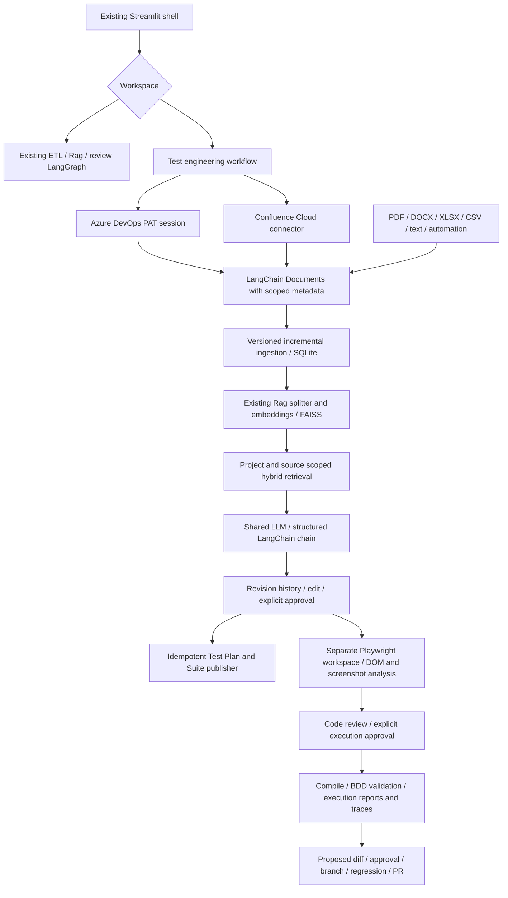

# Assessment before implementation

Historical baseline: this document describes the original repository and initial
migration plan. The user subsequently requested removal of the product-review
workflow. That UI, CSV pipeline, review graph and prompts are no longer part of the
application. The shared splitter and embedding factory remain. See the README for
the current architecture.

Inspected all Python/configuration files, dependency manifests, README, and the inventory
of CSV datasets and persisted FAISS artifacts. Secrets and pickle payloads were not read.
This directory has no `.git` or AGENTS.md and contained no tests.

## Existing implementation (phase 1)

| Concern | Observed implementation |
| --- | --- |
| Language/UI | Python 3.14.2, Streamlit 1.58.0; `app.py` calls `src/main.py` |
| LangChain | Installed 1.3.11, core 1.4.8, community 0.4.2; LangGraph 1.2.7 |
| LLM | `GroqLLM` creates ChatGroq; model list in INI; existing nodes share the client |
| Embeddings | `Rag.create_embeddings`, HuggingFaceEndpointEmbeddings, google/embeddinggemma-300m |
| Ingestion | pandas CSV cleanup, rating filtering, deduplication, positive/negative exports |
| Parsing | CSVLoader review_text content; product_id/title/category metadata |
| Chunking | RecursiveCharacterTextSplitter, 1000 characters, 200 overlap |
| Vector indexing | Three persisted FAISS indexes (all, positive, negative); local pickle loading |
| Retrieval | Default FAISS similarity retrievers exposed through LangChain retriever tools |
| Prompts/chains | Inline PromptTemplate; context summarization, binary relevance, rewrite, generation |
| Graph | agent → ToolNode → grade → generate or rewrite → agent |
| Memory | add_messages in a TypedDict; no durable checkpointer or cross-session conversation memory |
| API | None; Streamlit is the application entry point |
| UI | Product/model/key selectors, overall/positive/negative summaries |
| Configuration | INI, dotenv, environment; dependencies differ between requirements and pyproject |
| Authentication | Provider API keys only; no application login or project authorization |
| Evaluation | LLM binary relevance grading; no automated evaluation suite |
| Logging/reporting | Python logger, print diagnostics, Streamlit errors; no execution reporting |

README architecture descriptions lag the actual implementation: nodes use the injected
LLM client, rather than constructing a ChatGroq client per invocation.

## Reuse and enhancement decisions

Preserve the existing ETL, review indexes, graph, prompts and display. Reuse Rag's splitter,
embedding factory and FAISS implementation. Add optional constructor injection for generic
documents, keeping CSV calls compatible. Avoid routing engineering requirements through
review-specific prompts. Add a structured engineering chain using the same configured LLM.
Do not deserialize new untrusted pickle indexes; the new project index stores documents
in SQLite and reconstructs FAISS from saved numeric vectors.

Missing: service connectors; tenant/project/source scope; incremental sync; document
versions; story retrieval; test schemas; revision-bound approval; Test Plans publishing;
isolated automation workspaces; controlled execution; reports; evolution proposals.

## Integration architecture

## Migration and phase plan

1. Record this assessment and establish legacy regression tests.
2. Add authenticated, paginated Azure connector and discovery/story UI.
3. Extend Rag with injectable document dependencies; add Confluence/files and durable sync.
4. Add scoped story retrieval, traceable sources and hybrid ranking without re-embedding on selection.
5. Add validated structured generation, editable persisted revisions and approval invalidation.
6. Add plan/suite discovery/creation and resumable publishing with requirement links.
7. Add separate automation workspace, DOM/screenshot inspection and structured code proposals.
8. Gate validation/execution behind approval; capture reports, screenshots and traces.
9. Add reusable-pattern analysis and reviewable Git proposals; require approval before branch/PR work.

Each phase adds offline tests and documentation. Live Azure/Confluence/LLM/browser checks
require user credentials and an application environment. No live publishing or generated
code execution occurs during implementation. Local storage is single-user: deploy one
instance per trusted user until an identity provider and server-side grants are added.
